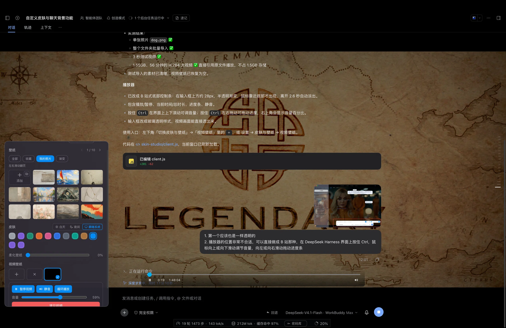

# 皮肤与壁纸（Skin Studio）

[](https://github.com/ghostmss86-afk/dsh-skin-studio/actions/workflows/check.yml)
[](LICENSE)
[](CHANGELOG.md)
[](#兼容性)

皮肤与壁纸是 DeepSeek Harness 的界面插件。它给界面换一套配色，并给聊天区铺上渐变、图片或视频壁纸；视频会整理成有封面、剧名和集号的卡片，文件夹可以整季按顺序播放。改动立即生效，选择保存在当前浏览器里。



## 功能

| 功能 | 说明 | 数量 / 前提 |
| --- | --- | --- |
| 预设皮肤 | 直接切换整套配色，同时覆盖浅色与深色 | 8 套 |
| 自定义皮肤 | 自选强调色与背景，保存后出现在「我的皮肤」 | 最多 12 套 |
| 渐变壁纸 | 内置渐变背景，随浅色 / 深色主题变化 | 9 套 |
| 图片壁纸 | 上传本地图片，或粘贴图片链接 | 最多 10000 张 |
| 视频壁纸 | 本地视频铺满聊天区：暂停 / 静音 / 音量 / 循环，F7 / F9 切上一个·下一个 | 最多 10000 个；非 AAC 音轨需要 ffmpeg |
| 视频卡片 | 封面 + 精简剧名 + 集号：`Billions.S06E01.1080p.WEBRip…` 显示为 `Billions.S06E01`；默认按季、集升序 | 设置页与左下角快捷面板同一套卡片 |
| 剧集文件夹 | 同一目录 ≥2 集自动折叠成文件夹卡片，显示 `S06E01 – S06E12` 与总集数；点一下从第 1 集按顺序播完整季，上一集 / 下一集不跑出该文件夹 | 需要导入时拿到真实路径 |
| 视频批量导入 | 一次多选、整目录导入、文件与文件夹拖拽；导入即落真实路径，并记住所属文件夹 | 设置页与左下角快捷面板同能力 |
| 全屏播放 | 双击页面顶部空白条或播放器控制条进入全屏，再双击 / Esc 退出 | 触摸屏双击同样有效 |
| 播放自检 | 设置页直接写出「原文件 / 音轨 / 画面静音 / 声音来源 / 源 / 网络 / 就绪」，一键复制 | 无需打开控制台；`网络`/`就绪` 对应 `networkState`/`readyState` |
| 显示模式 | 自录两个快捷键：一个进纯净模式（隐藏整个界面，只留壁纸），一个回正常界面；各自一键锁定、再按解除。光标在输入框里时不抢画面，进入时底部给出 3.2 秒退出提示。密码库入口移到设置里 | 快捷键需含 Ctrl / ⌘ / Alt |
| 界面自动隐藏 | 播放视频时停止操作 23 秒淡出应用界面；光标在输入框里时永不触发 | 设置里可关闭 |
| 硬件按键 | F7 上一个 / F8 播放暂停 / F9 下一个（也认系统媒体键） | 光标在输入框时不抢键 |
| 右下角播放带 | 贴在输入框那一栏正上方、宽度与该栏对齐：左边集号、中间一条透明轨道和一只小鲸鱼、右边 `当前 / 总长`。轨道按窗口宽度伸缩，窄到只剩鲸鱼时点住它左右拖也能调 | 只在视频壁纸下出现；暂停后不消失，换成图片 / 渐变才退出 |
| 进度拖动与跳转 | 按住小鲸鱼左右拖＝拖动进度；点轨道任意位置＝跳到该处并停在那一帧；拖到末尾停在末尾，不会从头重播 | 换算按轨道真实行程（104 − 22px）走，末端留 0.5 秒余量 |
| 输入框光晕 | 指针移到输入框上（或点进去）时，框外亮起一圈约 50px 的淡蓝漫反射，提示「这里可以打字」 | 会随所选皮肤的主色换色，默认是 DeepSeek 蓝 |
| 快捷面板材质 | 左下角「皮肤与壁纸」快捷面板用与侧边栏同一套毛玻璃：同源填充色 × 40% 不透明度 + `blur(40px) saturate(150%)` | 比侧边栏更透一档 |
| 收藏与筛选 | 「全部 / 收藏 / 我的照片 / 渐变」四个筛选，点星标收藏 | — |
| 柔化壁纸 | 在壁纸上叠一层柔光，保证文字可读 | 0–50%，默认 12% |
| 视频背景对比度 | 视频播放时聊天卡片、用户气泡、工具/文件卡片统一换成影院色板：深色半透明底 + 白色文字，日间模式也不会出现白底深字 | 仅视频背景；图片壁纸与无背景不变 |
| 半透明面板 | 让聊天卡片与侧栏透出壁纸 | 开关 |
| 实时预览 | 设置页显示当前皮肤与壁纸的缩略效果 | — |
| 恢复默认 | 只重置皮肤、壁纸与选项，自定义内容保留 | — |

## 安装

前置条件：DeepSeek Harness `0.2.2-rc.1`（本机验证版本）。视频壁纸的音频兜底需要 `ffmpeg` 与 `ffprobe` 在 `PATH` 里；没有时视频无声，画面正常。

### 方式零：插件市场

DSH 的「精选插件市场」数据来自社区目录 <https://awesome-dsh-plugin.com>（自动抓取 GitHub 上带 DSH 话题的仓库），目录本身没有人工提交表单。本仓库已公开、描述与话题齐全（`dsh-plugin`、`deepseek-harness`、`skin`、`theme`、`wallpaper`），抓取到之后会出现在市场里；在那之前请用下面任一方式安装。

### 方式一：从 GitHub 安装

```bash
dsh plugin --profile web add github:ghostmss86-afk/dsh-skin-studio
```

装完重启 DeepSeek Harness。之后升级用同一条命令加 `@<commit>` 或重装。

### 方式二：从 npm 安装

```bash
dsh plugin --profile web add dsh-plugin-skin-studio
```

### 方式三：profile link（跟随仓库更新）

```bash
git clone https://github.com/ghostmss86-afk/dsh-skin-studio.git ~/plugins/skin-studio
```

在该 profile 的 `package.json` 中加入依赖与 bundle：

```json
{
  "dependencies": {
    "dsh-plugin-skin-studio": "link:/Users/you/plugins/skin-studio"
  },
  "dsh": {
    "profile": {
      "bundles": ["dsh-plugin-skin-studio"]
    }
  }
}
```

在该 profile 目录执行 `pnpm install`，然后重启 DeepSeek Harness。

### 方式四：直接放目录

把仓库内容放到 profile 的 `node_modules/dsh-plugin-skin-studio`，bundle 配置同上。刷新页面即可生效。

> 依赖键、`bundles` 与 `package.json` 的 `name` 必须都是 `dsh-plugin-skin-studio`，三者不一致时 loader 找不到插件。

## 使用

- 入口一：左下角侧栏的「皮肤与壁纸」
- 入口二：设置 → 皮肤与壁纸
- 皮肤：点选预设，或在「自定义皮肤」里配色后保存，最多 12 套
- 壁纸：选渐变、上传图片或粘贴图片链接；点缩略图左侧星标收藏
- 视频壁纸：添加本地视频，播放器支持暂停、静音、音量与循环；右下角播放带的轨道可点、鲸鱼可拖，用来跳进度
- 视频卡片：每张卡片显示封面、精简剧名和集号（如 `Billions.S06E01`），默认按季、集从 1 往后排；原始文件名保留在悬停提示里
- 剧集文件夹：同一文件夹有 2 集以上时收成一张文件夹卡片，显示起止集号与总集数；点卡片从第 1 集开始按顺序播放，F7/F8/F9 都只在当前文件夹内切换
- 视频批量上传：和图片一样一次多选，或点加号磁贴右上角的文件夹按钮直接导入整个目录（设置页和左下角快捷面板都有），也可以把文件 / 文件夹拖到磁贴；导入后文件夹范围会持久保存
- 视频导入一律落真实文件路径：拖拽 / 普通文件框也会用「文件名 + 字节数」自动找回磁盘路径，避免退化成无声的 blob 记录；只拿到 Blob、没有路径的文件会作为单集卡片显示，不会误合并成文件夹
- 视频全屏：双击页面顶部空白条（或播放器控制条）进入全屏，再双击 / Esc 退出；播放时输入框区域保持透明，不糊字幕
- 视频没有声音时：设置页的「自检」行会直接写出原因（原文件 / 音轨 / 画面静音 / 声音来源 / 源 / 网络 / 就绪）；卡片左下角的链接按钮可以手动重新关联原文件，插件启动时也会按「文件名 + 字节数」自动找回
- 排查加载失败：`源` 会显示实际播放地址（本机回环压成 `loopback`），`网络` / `就绪` 是浏览器给的状态码；最近 20 条媒体事件（`folder:play`、`video:error`、`video:play-failed` 等）连同 `src/network/ready` 记在 localStorage 的 `debugLog` 里，也可以在控制台运行 `window.__skinStudioDiag()` 一次性打印当前状态
- 显示模式：设置里的「显示模式」段，点一下录制框再按组合键，分别给「纯净模式」和「正常模式」各录一个。第一次按锁定该模式，再按一次解除；某一个锁定期间，另一个快捷键不生效（面板里会写出当前状态）。纯净模式连按两次 `Esc` 可应急退出，进入时底部会显示 3.2 秒的提示条；光标停在输入框里时按纯净快捷键会被拦住（正在打字时画面不会被抢走），移开光标或按 Esc 即可。旁边的「界面自动隐藏（沉浸）」默认关闭，开启后也只在光标不在输入框时才淡出
- 选项：「柔化壁纸」滑块与「半透明面板」开关

## 数据与联网

| 内容 | 位置 |
| --- | --- |
| 当前选择与选项 | localStorage `dsh.skin-studio.v1` |
| 自定义皮肤、图片、视频 | IndexedDB `dsh-skin-studio`（version 2） |

插件不上传数据，也没有远程接口。只有两种操作会用到网络：

- 壁纸填的是图片链接时，浏览器按该链接加载图片
- 视频壁纸通过本机路由 `/api/skin-studio/media` 读取本地文件并流式返回，不经过外网

清空站点数据会一并清掉自定义皮肤、壁纸和视频。

## 已知限制

- HEVC / H.265 在 Electron 的 Chromium 里播放不流畅、跳转进度也不可靠；插件检测到后会后台转成 H.264 代理再播，转码完成时会自动回到原来的播放位置
- E-AC-3、DTS、TrueHD 等音轨 Chromium 无法解码，插件会用 ffmpeg 生成 AAC 侧车；宿主没能提供侧车时，画面会直接用视频元素自己的音轨，而不是整体静音
- 声音与进度条的约束、回归清单和历史故障见 [docs/video-playback.md](docs/video-playback.md)
- 「选择视频文件 / 选择文件夹」使用 macOS 的 `osascript`；其他系统请用设置面板里的文件选择入口
- 自定义皮肤上限 12 套，自定义壁纸与视频各上限 10000 条

## 目录结构

```
skin-studio/
├── client.js          # 浏览器侧：皮肤、壁纸、设置面板
├── index.js           # host 侧：媒体路由、ffmpeg 兜底
├── cordis.patch.yml   # loader 插入声明
├── locale/
│   ├── en.json
│   └── zh.json
├── docs/
│   ├── preview.webp      # 界面截图
│   ├── market-entry.yml  # 插件市场的收录条目
│   ├── video-playback.md # 视频声音/进度条的不变量与回归清单
│   └── display-modes.md  # 显示模式的状态机与接线说明
├── scripts/
│   ├── guard.mjs         # 媒体不变量静态检查
│   ├── guard.rules.json  # 规则即数据
│   ├── check-modes.mjs   # 显示模式的接线检查
│   ├── check-version.mjs # 版本四处一致性
│   └── bump.mjs          # 一次改完四处版本 + BUILD
├── icon.svg
├── package.json
├── CHANGELOG.md
└── LICENSE
```

## 兼容性

| 项目 | 状态 |
| --- | --- |
| DeepSeek Harness | `0.2.2-rc.1`，已在本机 macOS 验证 |
| 客户端注入点 | `@deepseek-ai/dsh-client-locale`、`-ui-layout`、`-ui-settings`、`-ui-sidebar`、`-ui-theme` |
| host 服务 | 优先用 `connection.fetch` 注册精确路由；旧宿主回退到 `webServer` 前缀注册，两者都不可用时降级为纯皮肤模式 |

## 实现

- `client.js` 由 `window.__ModuleLoader__` 加载，负责全部界面与逻辑，通过 theme 服务注入配色 token，通过 settings 服务注册设置页
- `index.js` 注册 12 条 `/api/skin-studio/media/*` 精确路由：`ping`、`origin.js`、`prepare`（AAC 侧车）、`video`（Range 流）、`poster`（封面）、`pick` / `pick-many` / `pick-folder`、`relink`、`proxy` / `proxy-file`（容器转封装）、`report`；同时启动只监听 `127.0.0.1` 的随机端口媒体服务器，路径带每进程 token
- `cordis.patch.yml` 把插件插入 profile 的 loader 层

## 开发

```bash
npm run verify                  # 提交前必跑：语法 + 接线 + 版本一致性 + 反模式
npm run bump -- 1.0.7           # 改版本只用这个（四处一起改，并刷新 BUILD）
npm run check                   # 语法 + 显示模式接线
npm run version:check           # 版本四处是否一致
npm run guard                   # 媒体不变量静态检查
```

`npm run verify` 是唯一入口，CI、`pre-push`、`prepublishOnly` 跑的都是它。

`npm run bump` 会自动改四处版本号（`package.json`、`client.js` 的 `PLUGIN_VERSION` / `BUILD`、README 徽章），
但**不会**改 CHANGELOG 与这份 README 的正文——功能说明每次发版都得手写补一段。
改动约定写在仓库根的 `AGENTS.md`：版本单一来源、同一能力单一实现、新增组件必须证明被 mount、
隐藏界面的功能必须有出口。

`scripts/guard.mjs` 与规则来自 [engineering-lessons](https://github.com/ghostmss86-afk/engineering-lessons)，
拦的是这个插件历史上真实踩过的坑（`file://` 音源、丢路径的 Blob 导入、`public.movie` 过滤等）。
`docs/video-playback.md` 是这些坑的完整说明与回归清单。

`scripts/check-modes.mjs` 拦的是另一类事故：功能、文案、样式都写了，但组件没被 mount、
或者隐藏规则把壁纸层一起藏掉。纯文本检查，无依赖，`npm run check` 与 CI 都会跑。

## 反馈

- 问题与建议：仓库 [Issues](https://github.com/ghostmss86-afk/dsh-skin-studio/issues)
- 版本变化：[CHANGELOG.md](CHANGELOG.md)

如果这个插件对你有用，点一下仓库右上角的 Star，方便下次找到。

## 许可

MIT，见 [LICENSE](LICENSE)。
